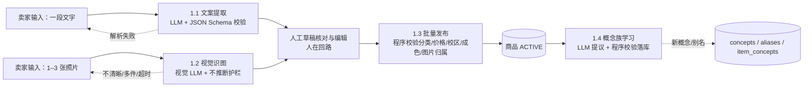
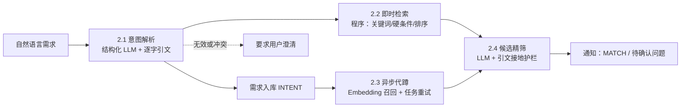

# AI 流水线、设计模式与模型选择

本文回答三个问题：本项目的 AI 节点如何在两条真实流水线中组合、每个大模型节点对应课程 21 种智能体设计模式中的哪些、以及每个节点的输入输出与护栏位置。模型选择的质量属性、候选模型、真实指标与取舍理由见 [AI_EVALUATION.md](AI_EVALUATION.md)。

## 1. 节点清单

| 节点 | 角色 | 实现性质 | 主要代码 |
|---|---|---|---|
| 1.1 文案提取 | 卖家把一段文字转成待核对草稿 | 大模型 + Pydantic 校验 | `backend/app/services.py` (`parse_item`)、`/api/v1/item-drafts/import`、`/api/v1/items/parse` |
| 1.2 视觉识图 | 卖家上传 1–3 张照片生成草稿 | 大模型（视觉）+ 不推断护栏 | `backend/app/vision.py` (`register_vision`)、`/api/v1/items/vision-draft`、`/api/v1/items/vision-batch` |
| 1.3 草稿审核与发布 | 人工核对、批量发布 | 程序 | `backend/app/draft_batches.py`、`/api/v1/item-drafts/import-vision`、`/api/v1/item-drafts/publish-batch`、`/api/v1/item-drafts/{id}/publish` |
| 1.4 概念族学习 | 商品发布后判定其所属概念族、别名与父类，沉淀为可复用知识 | 大模型提议 + 程序校验/落库 | `backend/app/concept_learning.py` (`propose`、`validate`、`apply_proposal`、`ConceptRunner`)、`backend/app/concepts.py` |
| 2.1 意图解析 | 自然语言需求转结构化条件 | 大模型 + 逐字引文护栏 | `backend/app/services.py` (`parse_intent_with_quotes`、`flatten_intent`)、`/api/v1/intents/parse` |
| 2.2 即时检索 | 概念展开、关键词检索、硬条件过滤、排序 | 程序 + 学习得到的目录快照 | `backend/app/search.py`、`backend/app/concepts.py`、`/api/v1/items/smart-search` |
| 2.3 异步代蹲 | 需求入库、概念/向量召回、异步任务与重试 | 程序 + 学习得到的目录快照 + Embedding | `backend/app/matching.py`、`MatchingRunner` |
| 2.4 候选精筛 | 对候选逐条判断 MATCH/NO_MATCH/UNCERTAIN | 大模型 + 引文接地护栏 | `backend/app/buyer_agent.py` (`review_candidates`、`Assessment.checked`) |

`2.2` 与 `2.3` 不是大模型节点；它们只使用程序检索、异步任务和可选的 Embedding 服务。本文不会把程序实现冒充成大模型设计模式。概念学习 1.4 是独立的大模型节点，只在商品发布或存量回填时运行，查询路径不调用模型。

## 2. 卖家流水线

关键事实：

- 文字与照片是**二选一或同时提供的输入**，不存在“1.1 必须先流入 1.2”的固定链。
- 两个 AI 节点都只产出草稿；发布动作必须经过人工核对和 1.3 的程序校验。
- 1.1 解析失败会回退到本地启发式解析（`parse_item_local`），但不会静默发布。
- 1.2 对空白、模糊、多主体返回 `unclear`/`multiple_items`，并给出需要用户确认的问题；识别结果有 5 分钟缓存和每小时次数限制。
- 1.4 在发布事务提交后异步运行：学习失败不影响商品上线，只把任务标记为可重试；本地模式没有模型可用，不运行 1.4，检索退回与旧版一致的确定性别名表。

## 3. 买家流水线

关键事实：

- 2.1 之后是**两条并行分支**：即时搜索 2.2 与后台代蹲 2.3；2.2 不会必然流转到 2.3。
- 2.4 只接收已通过程序硬条件过滤的候选；偏好不参与过滤，不能单独导致拒绝。
- 2.4 的 MATCH/NO_MATCH 必须给出来自商品原文的逐字引文；证据不接地会整批判定无效并重试，最终失败会记录 `FAILED` 供用户重试。
- 当前部署未配置 Embedding 服务，2.3 以词面召回运行；Embedding 路径保留但本次评测标记为 `UNAVAILABLE`，不冒充已启用。
- 2.2/2.3 使用的概念目录来自 1.4 写入数据库的学习结果；查询路径只读进程内快照，不调用模型。

### 3.1 商品概念族学习（1.4）与运行时用法（2.2/2.3）

自然语言检索需要处理“电脑/笔记本/MacBook”“鼠标/鼠标垫”这类表述差异。知识不是写死在代码里的目录：商品发布后，1.4 让模型阅读商品文本和数据库中已有概念目录，判断它属于哪些概念族、哪些词应成为别名、父类是什么；判断经程序校验后写入数据库。查询时只读数据库快照，不再调用模型。

| 表 | 作用 |
|---|---|
| `concepts` | 概念词条：`id`、标准名、释义、`parent_id`（如 电脑 → 笔记本 / 台式机）、所属分类 |
| `concept_aliases` | 模型判定并写入的别名/中英写法 → 概念（如 macbook → 笔记本） |
| `item_concepts` | 商品 → 概念的物化链接，支撑“商品→概念→同类商品”的双向查找 |
| `concept_proposals` | 每次模型的原始提议、状态（APPLIED/REJECTED）、拒绝原因、模型与提示词版本，供审计 |
| `concept_jobs` | 可重试的学习队列：PENDING/RUNNING/DONE/FAILED、尝试次数与退避时间 |

运行路径：

1. **学习触发**：商品发布或批量发布提交后，`ConceptRunner` 把商品写入 `concept_jobs` 并在后台消费；远程模式启动时，仅对没有概念链接的**真实存量商品**回填（演示数据不消耗模型调用）。模型看到的是商品文本与当前目录，返回“复用已有 concept_id / 新建概念 / 父概念 / 别名 / 逐字证据”。
2. **程序校验**：证据必须逐字出现在标题、描述或标签中；别名必须出现在商品文本中且不能是成色、价格、校区等属性词；别名冲突、未知概念、非法分类、父类环、层级过深、目录规模上限都会拒绝整份提议，并写入 `concept_proposals` 的拒绝原因。
3. **落库与回链**：通过的提议按父类优先写入 `concepts`/`concept_aliases`，然后重新链接商品；`笔记本` 的父类可由模型凭世界知识声明为 `电脑`，即使商品文本没有出现“电脑”。每次写入都有审计行。
4. **查询展开**：查“电脑”会向下展开到笔记本及其别名；查“笔记本”只命中笔记本，不会反向泛化到父类。商品列表检索通过 `item_concepts` 子查询召回，智能搜索使用同一目录展开与整词匹配；2.3 的本地逐条审查也使用同一套规范化与整词匹配。
5. **配件隔离**：模型被明确要求把鼠标垫、保护膜、支架等判为独立概念；运行时最长别名优先，规范化结果以空格分隔，整词匹配避免“鼠标”命中“鼠标垫”。
6. **本地回退**：`AI_MODE=local` 没有可调用的模型，1.4 不运行；`services.py` 保留概念库之前的 `FEATURES` 字面别名表作为确定性回退。该回退明确不是学习结果，只在本地模式生效，并在测试中与学习目录分开验证。

该路径把模型的语义判断**一次沉淀、多次复用**：同一族后续商品只需查表，不必重复调用模型。目录快照保存在进程内，当前按单进程部署运行；多 worker 部署需要额外的失效/重启机制。代价是学习质量依赖模型判断，护栏只能拒绝明显错误（编造证据、属性别名、冲突、环、超限），不能保证语义完全正确；所有提议都有审计记录，错误词条目前需要人工从数据库修正，尚未实现在线回滚或人工审核界面。

## 4. 课程 21 种智能体设计模式逐项映射

“使用”指代码中真实落地；“部分使用”指只具备该模式的程序化形式或受限形式；“未使用”表示没有实现，报告中不声称使用。

| # | 模式 | 状态 | 落地位置与说明 |
|---:|---|---|---|
| 1 | 提示链 Prompt Chaining | 部分使用 | 1.1/1.2/2.1/2.4 各自是单次模型调用；跨节点由程序与人工串联，不是 LLM 之间的自动链 |
| 2 | 路由 Routing | 使用（程序） | 2.1 的结果按用户操作进入 2.2 即时检索或 2.3 代蹲；由接口与用户选择路由，非模型路由 |
| 3 | 并行化 Parallelization | 未使用 | 同一请求内没有并行模型调用 |
| 4 | 反思 Reflection | 未使用 | 没有让模型自评再改写的循环；护栏是确定性校验 |
| 5 | 规划 Planning | 未使用 | 没有任务分解或行动计划生成 |
| 6 | 工具使用 Tool Use | 未使用 | 模型不调用外部工具；检索与发布由程序执行 |
| 7 | 多智能体 Multi-Agent | 未使用 | 每个节点一个受限角色提示词，没有智能体间协商 |
| 8 | 记忆 Memory | 部分使用（程序持久化，不是 LLM 记忆） | 需求、通知与任务状态存放在数据库中；1.4 把模型判断写成 `concepts`/`concept_aliases` 持久知识，后续请求复用，但模型本身不带对话记忆 |
| 9 | MCP | 未使用 | 未接入 MCP 工具协议 |
| 10 | 人在回路 Human-in-the-Loop | 使用 | 1.2/1.1 草稿必须人工核对后发布；2.4 的 UNCERTAIN 生成向卖家确认的问题；学习提议有审计记录，但当前没有上线前的人工审核界面 |
| 11 | 护栏与安全 Guardrails/Safety | 使用 | JSON Schema/严格 Pydantic 校验；逐字引文接地；否定与排除检查；注入语句不执行；图片归属校验；学习提议的证据/别名接地、冲突、环与容量校验；不泄露密钥 |
| 12 | 异常处理与恢复 Exception Handling/Recovery | 使用 | 超时/429/5xx 退避重试；解析失败回退本地；匹配任务 `FAILED` 可重试；学习任务持久化队列，失败可重试且不阻塞发布；识图 504/502/429 明确错误 |
| 13 | 资源感知优化 Resource-Aware Optimization | 部分使用 | 候选上限 10、批量审查、token 上限、5 分钟识图缓存、每小时识图限额、单用户并发限制；学习只对新发布/未链接商品触发，查询不调用模型 |
| 14 | 评估与监控 Evaluation/Monitoring | 使用 | `backend/eval/` 人工标注集与真实模型评测；usage/阶段耗时观察回调；日志记录结果类型与耗时；学习提议按 APPLIED/REJECTED 审计 |
| 15 | 广义 RAG | 部分使用 | 2.4 对程序召回的候选做“检索 + 接地生成”；2.2/2.3 的概念展开是符号表检索，不是向量 RAG；1.4 把模型提议写成可检索的符号目录，属于知识沉淀而非检索生成；2.3 的向量召回当前未启用 |
| 16 | 目标监控 Goal Monitoring | 使用（程序） | 2.3 对 ACTIVE 需求持续匹配，售出/暂停/完成会停止匹配 |
| 17 | 优先级排序 Prioritization | 使用（程序） | 2.2 按相关度/价格/时间排序；2.4 候选按相似度与价格截断 |
| 18 | 学习与适应 Learning/Adaptation | 使用（受限） | 1.4 在商品入库时让模型判断概念族/别名/父类，经确定性校验后持久化，后续查询复用；这是受限的在线学习：只扩充符号目录，不改提示词、不更新模型权重，错误提议需要人工修正 |
| 19 | 自我一致性 Self-Consistency | 未使用 | 不采样多次投票 |
| 20 | ReAct | 未使用 | 没有“推理-行动”交替循环 |
| 21 | 思维链/逐步推理 Chain-of-Thought | 未使用 | 提示词要求直接输出结构化 JSON，不采集或展示推理过程 |

## 5. 每个 AI 节点的工程约束

| 节点 | 输入 → 输出 | 模型调用 | 护栏 | 恢复 | 人在回路 | 资源约束 |
|---|---|---|---|---|---|---|
| 1.1 | 文本 → `ParsedItem` 草稿 | `chat_json`，JSON object，`item-2` | 字段枚举校验、标题/描述长度、价格范围；不执行文本中的指令 | 失败回退 `parse_item_local`；超时/429 重试 | 卖家核对草稿后才能发布 | `max_tokens=2500`，超时由配置控制 |
| 1.2 | 1–3 张照片 → `VisionDraft`/`VisionBatch` | 视觉模型，`vision-publish-3` | 只写可见证据；未知字段为 null；禁止推断品牌/材质/成色/功能；空白/多主体降级 | 429/5xx 重试一次；超时 504；结果无效 502；缓存 5 分钟 | 草稿由卖家确认后发布 | 每小时限额、单用户并发、最多 10 件、图片大小/像素上限 |
| 1.3 | 已核对草稿 → ACTIVE 商品 | 无 | 字段/图片归属/分类价格校区成色校验；发布事务与入队原子性 | 入队失败整批回滚；重复发布幂等 | 卖家核对后才能发布 | 每批最多 10 件，草稿上限 50 |
| 1.4 | 商品文本 + 当前目录 → 概念族/别名/父类提议 | `chat_json`，`concept-1` | 证据与别名逐字接地；拒绝属性别名/未知概念/别名冲突/父类环/深度/容量超限；提示词声明商品文本不可信 | 持久队列，`ModelUnavailable` 与其他错误退避重试，最多 3 次；失败不影响发布 | 提议状态与拒绝原因可审计；当前无人工审核界面 | 每次最多 4 个归属、6 个别名、5 个新概念；目录上限 500；查询路径零模型调用 |
| 2.1 | 文本 → `ParsedIntent`（内部含逐字引文） | `chat_json`，结构化 JSON，`intent-3` | 角色 required/preferred/excluded；引文必须是原文子串；非法枚举/负价格被清洗；注入语句被忽略 | 失败 502，不写入半成品 | 解析结果展示给用户确认后再创建需求 | 单次调用，1200–2500 token |
| 2.4 | 需求 + 候选 → 判定与证据 | `chat_json`，批量，`review-1` | evidence 的 criterion 必须来自需求；quote 必须逐字来自商品；NO_MATCH 不能只靠偏好；MATCH 不能出现排除词；缺必需证据降级 UNCERTAIN | 整批无效则 `ModelUnavailable`，任务重试/失败可重试 | UNCERTAIN 向卖家生成确认问题 | 每批最多 10 个候选，`max_tokens=5000` |

## 6. 模型选择摘要

候选模型 ID 写在 `backend/eval/models.json`（可用同名环境变量覆盖），仓库不保存密钥。决策顺序是“可用性硬过滤 → 该节点预注册硬门禁 → 主指标 → p95/token”，只在 dev 集选型、sealed 只给胜者跑一次，详见 [AI_EVALUATION.md](AI_EVALUATION.md) §3.1 与 §8.1。本轮 5 个文本/视觉候选全部可用（Embedding 未配置，2.3 以词面召回运行）：

| 阶段 | 节点 | 胜者 | 说明 |
|---|---|---|---|
| 1.1 | 文案提取 | `text-alt` `deepseek/deepseek-v4-pro-0813` | dev F1 0.873 vs 主候选 0.867，差距小；生产若采用需按节点拆分模型配置 |
| 1.2 | 视觉识图 | `vision-primary` `qwen/qwen3.7-flash` | dev 状态准确率 1.000；sealed 无依据属性 0.333 未达标 |
| 2.1 | 意图解析 | `text-alt` `deepseek/deepseek-v4-pro-0813` | dev F1 0.880 且延迟更低；sealed 引文召回 0.931、1 次供应商失败 |
| 2.4 | 候选精筛 | `text-primary` `deepseek/deepseek-v4.1-flash` | dev 唯一全过硬门禁；sealed 判定准确率 0.778（软指标未过） |
| 1.4 | 概念族学习 | 无胜者，保留 `text-primary` | 三个候选 `alias_f1` 均低于 0.70；金标为 AI 起草待人工复核 |

生产端仍只有一个文本模型服务 1.1/2.1/2.4/1.4；上表的文本分歧只作为建议，本轮不改部署配置。失败样例、逐例通过/不通过计数与全部调用/token 见 [AI_EVALUATION.md](AI_EVALUATION.md) §7.1、§8.1、§9.1。
