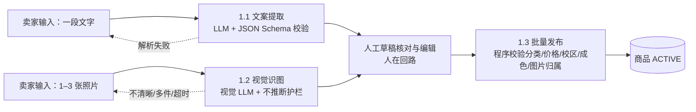
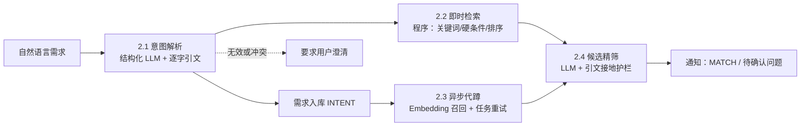

# AI 流水线、设计模式与模型选择

本文回答三个问题：本项目的 AI 节点如何在两条真实流水线中组合、每个大模型节点对应课程 21 种智能体设计模式中的哪些、以及每个节点的输入输出与护栏位置。模型选择的质量属性、候选模型、真实指标与取舍理由见 [AI_EVALUATION.md](AI_EVALUATION.md)。

## 1. 节点清单

| 节点 | 角色 | 实现性质 | 主要代码 |
|---|---|---|---|
| 1.1 文案提取 | 卖家把一段文字转成待核对草稿 | 大模型 + Pydantic 校验 | `backend/app/services.py` (`parse_item`)、`/api/v1/item-drafts/import`、`/api/v1/items/parse` |
| 1.2 视觉识图 | 卖家上传 1–3 张照片生成草稿 | 大模型（视觉）+ 不推断护栏 | `backend/app/vision.py` (`register_vision`)、`/api/v1/items/vision-draft`、`/api/v1/items/vision-batch` |
| 1.3 草稿审核与发布 | 人工核对、批量发布 | 程序 | `backend/app/draft_batches.py`、`/api/v1/item-drafts/import-vision`、`/api/v1/item-drafts/publish-batch`、`/api/v1/item-drafts/{id}/publish` |
| 2.1 意图解析 | 自然语言需求转结构化条件 | 大模型 + 逐字引文护栏 | `backend/app/services.py` (`parse_intent_with_quotes`、`flatten_intent`)、`/api/v1/intents/parse` |
| 2.2 即时检索 | 关键词检索、硬条件过滤、排序 | 程序 | `backend/app/search.py`、`/api/v1/items/smart-search` |
| 2.3 异步代蹲 | 需求入库、向量化、异步召回与重试 | 程序 + Embedding | `backend/app/matching.py`、`MatchingRunner` |
| 2.4 候选精筛 | 对候选逐条判断 MATCH/NO_MATCH/UNCERTAIN | 大模型 + 引文接地护栏 | `backend/app/buyer_agent.py` (`review_candidates`、`Assessment.checked`) |

`2.2` 与 `2.3` 不是大模型节点；它们只使用程序检索、异步任务和可选的 Embedding 服务。本文不会把程序实现冒充成大模型设计模式。

## 2. 卖家流水线

关键事实：

- 文字与照片是**二选一或同时提供的输入**，不存在“1.1 必须先流入 1.2”的固定链。
- 两个 AI 节点都只产出草稿；发布动作必须经过人工核对和 1.3 的程序校验。
- 1.1 解析失败会回退到本地启发式解析（`parse_item_local`），但不会静默发布。
- 1.2 对空白、模糊、多主体返回 `unclear`/`multiple_items`，并给出需要用户确认的问题；识别结果有 5 分钟缓存和每小时次数限制。

## 3. 买家流水线

关键事实：

- 2.1 之后是**两条并行分支**：即时搜索 2.2 与后台代蹲 2.3；2.2 不会必然流转到 2.3。
- 2.4 只接收已通过程序硬条件过滤的候选；偏好不参与过滤，不能单独导致拒绝。
- 2.4 的 MATCH/NO_MATCH 必须给出来自商品原文的逐字引文；证据不接地会整批判定无效并重试，最终失败会记录 `FAILED` 供用户重试。
- 当前部署未配置 Embedding 服务，2.3 以词面召回运行；Embedding 路径保留但本次评测标记为 `UNAVAILABLE`，不冒充已启用。

## 4. 课程 21 种智能体设计模式逐项映射

“使用”指代码中真实落地；“部分使用”指只具备该模式的程序化形式或受限形式；“未使用”表示没有实现，报告中不声称使用。

| # | 模式 | 状态 | 落地位置与说明 |
|---:|---|---|---|
| 1 | 提示链 Prompt Chaining | 部分使用 | 1.1/1.2/2.1/2.4 各自是单次模型调用；跨节点由程序与人工串联，不是 LLM 之间的自动链 |
| 2 | 路由 Routing | 使用（程序） | 2.1 的结果按用户操作进入 2.2 即时检索或 2.3 代蹲；由接口与用户选择路由，非模型路由 |
| 3 | 并行化 Parallelization | 未使用 | 同一请求内没有并行模型调用 |
| 4 | 反思 Reflection | 未使用 | 没有让模型自评再改写的循环；护栏是确定性校验 |
| 5 | 规划 Planning | 未使用 | 没有任务分解或行动计划生成 |
| 6 | 工具使用 Tool Use | 未使用 | 模型不调用外部工具；检索与发布由程序执行 |
| 7 | 多智能体 Multi-Agent | 未使用 | 每个节点一个受限角色提示词，没有智能体间协商 |
| 8 | 记忆 Memory | 未使用（无 LLM 记忆） | 需求、通知与任务状态存放在数据库中，属于程序状态，不是模型记忆 |
| 9 | MCP | 未使用 | 未接入 MCP 工具协议 |
| 10 | 人在回路 Human-in-the-Loop | 使用 | 1.2/1.1 草稿必须人工核对后发布；2.4 的 UNCERTAIN 生成向卖家确认的问题 |
| 11 | 护栏与安全 Guardrails/Safety | 使用 | JSON Schema/严格 Pydantic 校验；逐字引文接地；否定与排除检查；注入语句不执行；图片归属校验；不泄露密钥 |
| 12 | 异常处理与恢复 Exception Handling/Recovery | 使用 | 超时/429/5xx 退避重试；解析失败回退本地；匹配任务 `FAILED` 可重试；识图 504/502/429 明确错误 |
| 13 | 资源感知优化 Resource-Aware Optimization | 部分使用 | 候选上限 10、批量审查、token 上限、5 分钟识图缓存、每小时识图限额、单用户并发限制 |
| 14 | 评估与监控 Evaluation/Monitoring | 使用 | `backend/eval/` 人工标注集与真实模型评测；usage/阶段耗时观察回调；日志记录结果类型与耗时 |
| 15 | 广义 RAG | 部分使用 | 2.4 对程序召回的候选做“检索 + 接地生成”，但检索不是向量库主链路；2.3 的向量召回当前未启用 |
| 16 | 目标监控 Goal Monitoring | 使用（程序） | 2.3 对 ACTIVE 需求持续匹配，售出/暂停/完成会停止匹配 |
| 17 | 优先级排序 Prioritization | 使用（程序） | 2.2 按相关度/价格/时间排序；2.4 候选按相似度与价格截断 |
| 18 | 学习与适应 Learning/Adaptation | 未使用 | 没有在线学习或根据反馈自动改提示词 |
| 19 | 自我一致性 Self-Consistency | 未使用 | 不采样多次投票 |
| 20 | ReAct | 未使用 | 没有“推理-行动”交替循环 |
| 21 | 思维链/逐步推理 Chain-of-Thought | 未使用 | 提示词要求直接输出结构化 JSON，不采集或展示推理过程 |

## 5. 每个 AI 节点的工程约束

| 节点 | 输入 → 输出 | 模型调用 | 护栏 | 恢复 | 人在回路 | 资源约束 |
|---|---|---|---|---|---|---|
| 1.1 | 文本 → `ParsedItem` 草稿 | `chat_json`，JSON object，`item-2` | 字段枚举校验、标题/描述长度、价格范围；不执行文本中的指令 | 失败回退 `parse_item_local`；超时/429 重试 | 卖家核对草稿后才能发布 | `max_tokens=2500`，超时由配置控制 |
| 1.2 | 1–3 张照片 → `VisionDraft`/`VisionBatch` | 视觉模型，`vision-publish-3` | 只写可见证据；未知字段为 null；禁止推断品牌/材质/成色/功能；空白/多主体降级 | 429/5xx 重试一次；超时 504；结果无效 502；缓存 5 分钟 | 草稿由卖家确认后发布 | 每小时限额、单用户并发、最多 10 件、图片大小/像素上限 |
| 2.1 | 文本 → `ParsedIntent`（内部含逐字引文） | `chat_json`，结构化 JSON，`intent-3` | 角色 required/preferred/excluded；引文必须是原文子串；非法枚举/负价格被清洗；注入语句被忽略 | 失败 502，不写入半成品 | 解析结果展示给用户确认后再创建需求 | 单次调用，1200–2500 token |
| 2.4 | 需求 + 候选 → 判定与证据 | `chat_json`，批量，`review-1` | evidence 的 criterion 必须来自需求；quote 必须逐字来自商品；NO_MATCH 不能只靠偏好；MATCH 不能出现排除词；缺必需证据降级 UNCERTAIN | 整批无效则 `ModelUnavailable`，任务重试/失败可重试 | UNCERTAIN 向卖家生成确认问题 | 每批最多 10 个候选，`max_tokens=5000` |

## 6. 模型选择摘要

真实候选模型由 `backend/eval/models.json` 通过环境变量解析，不在仓库保存密钥。评测采用“硬约束过滤 → 准确率/召回 → 延迟/成本 → Pareto 选择”的顺序，逐节点的真实结果、失败样例、成本与不可用候选见 [AI_EVALUATION.md](AI_EVALUATION.md)。未配置的备用候选在报告中保持 `UNAVAILABLE`，不以平均值掩盖。
